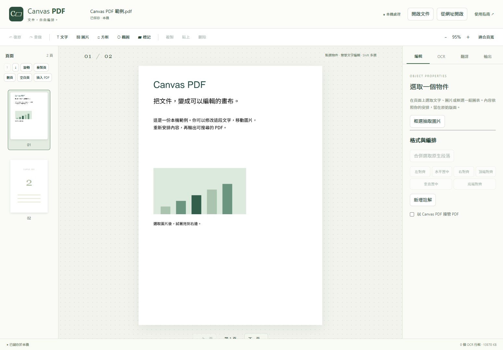

# Canvas PDF 0.1.1

> **開發狀態：暫停（2026-11-08）**。依使用者指示暫停後續開發與驗收，目前保留 0.1.1 本機預覽版。現有程式、離線包、來源包、驗收紀錄與已知限制均保留；恢復開發等待使用者另行指示。

本 repo 保存暫停時的原始碼快照；離線 ZIP 與完整執行資產屬本機建置產物，尚未上傳 GitHub Release。可依下方步驟重建，現有驗收與未完成項目詳見 [開發狀態](STATUS.md)。

以 HTML-in-Canvas 操作原生 PDF 段落、圖片與圖形，並在 Chrome 本機辨識、校正及重建掃描文字。這是系列第四個插件，採獨立 AGPL-3.0-only 授權，交付本機預覽版。



[使用指南](public/GUIDE.html) · [驗收紀錄](ACCEPTANCE.md) · [固定來源與適配](SOURCES.md) · [第三方聲明](THIRD_PARTY_NOTICES.md)

0.1.1 修正頁面雙擊編輯、右側選取文字、自動選取 OCR 結果及繁中文字型誤用；詳見 [本輪審查](REVIEW-20261108.md)。套用編輯文字會重建掃描區域；OCR 分頁的「套用校正」保留目前工作模式。已有文字層卻無法編輯時，可使用「整頁強制辨識（含既有文字）」，再選擇點陣化輸出。

## 安裝

1. 使用 Chrome 157 以上，解壓 `canvas-pdf-0.1.1-offline.zip` 到固定資料夾。
2. 開啟 `chrome://extensions`，啟用開發人員模式，按「載入未封裝項目」，選取解壓後含 `manifest.json` 的資料夾。
3. 點插件圖示開啟工作台，再選檔、拖入 PDF，或先試用範例文件。

使用者只需 Chrome。EditCore WASM、PP-OCRv6 small／medium FP32、ONNX Runtime、OpenCV 與繁中字型均隨包提供。Chrome Translator 的語言包由瀏覽器另行管理；Gemini 是使用者選用的網路來源。

## 已提供的操作

- 修改既有段落、字級、字型、顏色、行距、對齊、框內換行、拆分／合併；中文以真實 DOM 輸入。
- 圖片移動、縮放、旋轉、替換、複製、刪除；圖形框選、群組、對齊與圖層操作。
- 新增文字、圖片、方框、橢圓、標記及註解；頁面排序、旋轉、插入、複製與刪除。
- 整頁或局部 OCR、校正、拆框／合框、讀序、遮罩及背景取樣；保留原圖搜尋文字層，或擦除來源後重建。
- CPU 1／2／4 緒與 WebGPU；記錄實際 provider，失敗時明示回退。OCR 快取包含影像、模型及管線版本。
- Chrome 本機翻譯優先，選用匿名 Gemini RPC；段落、目前頁面及全文範圍，保留原文與譯文，校訂後可套用。
- 編輯版、搜尋版、譯文版、選頁雙語配對及明確的整頁點陣化輸出。PDF.js 逐頁擷取與渲染驗證後才下載。
- 跨頁復原／重做、序列自動保存、SHA-256 原檔識別及專案 ZIP 備份／恢復；重啟重建穩定物件對應。

PDF 接管預設關閉。MIME API 與選項已接線，公開 HTTPS 與本機檔案已通過；loopback HTTP 重跑的限制見驗收紀錄；一般選檔入口可直接使用，接管頁面另提供獨立分頁繼續編輯。

## 開發與重建

Node.js 24；Python 3.14 只供資產準備及開發驗收。請從來源 ZIP 的 `Canvas PDF` 目錄執行：

```powershell
npm ci
python scripts/prepare_assets.py
npm run check
npm test
npm run build
```

`package-lock.json` 固定 npm 依賴；`assets.lock.json` 固定引擎、模型與字型的 SHA-256。已有資產或重新下載的內容與鎖定摘要不符時，準備／打包會失敗。模型於建置時取得，執行時使用本地資產。

`npm run build` 產出 `dist/` 未封裝插件，以及上層 `dist/canvas-pdf-0.1.1-offline.zip`、`canvas-pdf-0.1.1-source.zip` 與 SHA-256 清單。來源包包含修改後程式、共用層、建置腳本、測試、鎖檔及固定版本 EditCore 對應原始碼封存；模型與執行庫隨離線包提供。

新 clone 的建置不需要本機驗收 output。可用 `npx vite build` → `node scripts/package.mjs --without-evidence` → `python scripts/verify_package.py --hash-only` 執行與 CI 相同的套件檢查。`verification/index.json` 明列實際附入與缺少的驗收紀錄；建置成功不能代替瀏覽器驗收。

瀏覽器驗收：

```powershell
python -m venv .venv
.\.venv\Scripts\python.exe -m pip install -r requirements-test.txt
.\.venv\Scripts\python.exe scripts/fixtures.py
.\.venv\Scripts\python.exe scripts/acceptance.py
.\.venv\Scripts\python.exe scripts/acceptance.py --dom
.\.venv\Scripts\python.exe scripts/ocr_edit_acceptance.py
.\.venv\Scripts\python.exe scripts/ocr_edit_acceptance.py --dom
.\.venv\Scripts\python.exe scripts/extended_acceptance.py
.\.venv\Scripts\python.exe scripts/runtime_acceptance.py
.\.venv\Scripts\python.exe scripts/shared_image_acceptance.py
.\.venv\Scripts\python.exe scripts/ocr_matrix.py
.\.venv\Scripts\python.exe scripts/evaluate_ocr.py
```

測試使用原創文件、隔離設定檔及實際安裝的 Chrome，結果位於 `output/`。`fixtures.py` 會從 `benchmarks/` 複製並驗證凍結的 40 頁輸入，另建立幾何／密碼案例。真實翻譯探測另有 `native_translation_probe.py`、`gemini_probe.py`，後者會傳送一段固定原創測試文字，並使用預先授權來源的測試 manifest。

## 架構與資料

`pdf.worker.ts` 統一持有工作 PDF；EditCore 執行文字與物件寫回，`Stage.tsx` 使用共用 HTML-in-Canvas 幾何層。能力不足時切換 DOM。PDF 旋轉段落的局部座標、CropBox 與仿射矩陣分別處理；WASM 指標不寫入專案。

`identity.ts` 保存穩定 ID 與物件描述，重新載入時建立對應；Worker generation 拒絕過期操作。IndexedDB 保存原檔、工作副本、行框、譯文、工作紀錄及有上限的 OCR 快取。一次操作共用一個歷史步驟，歷史最多 24 步、工作 PDF 快照合計上限約 128 MiB。

`ocr.worker.ts` 執行官方 PaddleOCR.js 管線，單頁排程與有限辨識批次。OpenCV 與 ORT 固定版的動態工廠改為 closure，保留 MV3 CSP；原始模型預設、CDN 回退及 SDK 第二層 Worker 入口已移除。

## 使用邊界

- 本版採自由排版與框內換行。文章跨框／跨頁流動、表格資料／公式語意編輯、正式去識別化、表單與簽章工具列為後續項目。
- 多段原生文字貼上會尋找空白位置，避免引擎將副本併入原段落；空間不足時會提示先插入空白頁。
- 複製支援原生文字、圖片與 OCR 行框；複雜路徑／Form 的複製會提示改用區域抽取，原生群組仍可移動與縮放。
- 來源圖片含裁切或透明合成時，像素替換會顯示限制；保留原圖 OCR 可繼續使用。也可明確另存點陣化副本，再開啟編輯。
- 區域 OCR 與既有 PDF 文字重疊時，搜尋版略過該區的隱藏 OCR 層；可見 OCR 重建輸出需選擇明確的「點陣化 PDF」，或改用原生段落編輯。這可避免舊字仍留在擷取結果。
- 擦字採填色／背景取樣；複雜背景、印章、表格線需人工核對。此功能屬編輯操作；原檔與專案備份仍含原始內容。
- 缺少可用原字型時使用隨包 Noto CJK TC；版面與字形需要核對。原生段落、向量與特殊 PDF 的支援由 EditCore 能力決定。
- 含簽章文件在工作台與輸出面板顯示影響提示。密碼文件建立已解鎖的工作副本，原始檔保留。
- 匿名 Gemini 協定可能改版。已提交後中斷會標示結果未知並鎖定，已完成結果保留；解除鎖定後才可由使用者重送。
- 實體 IME、使用者設定檔及真實文件人工金標尚待驗收，詳見驗收紀錄。

## 授權

Canvas PDF 整合並適配 BentoPDF／EditCore，衍生程式採 [AGPL-3.0-only](LICENSE)。共用 HTML-in-Canvas 與既有三個插件保留各自授權。字型、模型、PDFium 與其他執行依賴保留各自聲明；本機包內附 `licenses/`、來源清單與逐檔摘要。公開發布及商店上架另行處理。
