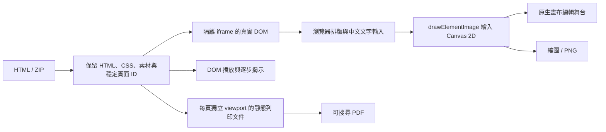

# Canvas Slides 的 HTML-in-Canvas 用途與優化順序

## 現在的資料與渲染流程

- [stage.ts](src/stage.ts) 把投影片 DOM 放進帶有 `content="drawable"`（舊版為 `layoutsubtree`）的 canvas。`paint` 事件中，先依 devicePixelRatio 設定畫布，再由 `drawElementImage(root, ...)` 繪出瀏覽器完成排版的文字、圖片與 CSS。
- [共用相容層](../shared/html-in-canvas/canvas.ts) 偵測 API。新 API 自動同步繪製位置與事件命中位置；舊 API 使用矩陣與 `updateElementGeometry()`。中文文字編輯仍使用 DOM 的 `contenteditable`；Moveable 修改 DOM 的位置、大小與旋轉。
- 編輯資料保存為 HTML 與 CSS。文字在原生畫布上仍可雙擊編輯，並由瀏覽器維持文字選取、組字與語意。PNG 與縮圖取自同一張完成繪製的 canvas。
- 播放、獨立 HTML 及 PDF 各有明確路徑：播放使用 DOM 執行可信動畫；PDF 使用靜態 DOM 保留可搜尋文字。這幾項輸出共用文件資料及底色規則。PDF 的列印文件沒有動畫 runtime，並等待所有子頁字型與圖片解碼完成。
- 沒有 HTML-in-Canvas API 時，保留 DOM 編輯及 HTML／專案／PDF 輸出。PNG 需要原生 API，介面會反映這個能力差異。

目前的 canvas 每次繪製整張投影片的 DOM 子樹。群組、圖層與自由物件的結構由 HTML/CSS 保存；編輯器尚未建立每個物件各有紋理的 GPU 場景圖。

## v0.1.2 的修正與證據

- 底色：為淺色／暗色頁提供明確的主題底層，手動選定純色時移除模板遮罩，讓編輯、播放與輸出一致；屬性欄顯示目前實際底色。使用者最初遇到的間歇性黑底，在重新匯入同一 ZIP 後恢復正常；該次狀態的確切觸發條件仍待實機確認。
- 列印：每頁在固定尺寸 iframe 排版，避免多頁文件改變 `vw/vh` 的意義；完全顯示動畫內容，等待字型、內嵌圖片及 CSS 背景圖後才呼叫列印。五頁 PDF 經文字擷取與逐頁像素比對。
- 播放：依可用區域及簡報比例計算最大尺寸，可超過 100% 放大；點畫面、空白鍵及「下一步」共用進度控制。流程頁每次揭示一項，系統減少動態效果時仍保留步驟順序。
- [fidelity_acceptance.py](scripts/fidelity_acceptance.py) 覆蓋原生 MV3、重複匯入、PNG、獨立 HTML、完整 PDF、放大比例、減少動態效果及逐步播放。使用者設定檔、實體 IME、跨螢幕 DPI、GPU 驅動與系統列印對話框仍有人工驗收項目。

## 下一步的 Canvas 優化

| 優先 | 方向 | 預期改善與驗收方式 |
|---|---|---|
| 1 | 重繪與縮圖排程 | 同一幀合併變更；未變更投影片快取縮圖，切頁後丟棄過期工作。量測 50／200 頁的切頁延遲與記憶體。 |
| 2 | 編輯與輸出解析度分開 | 編輯依畫面與 DPI 動態取樣，PNG 依指定輸出尺寸繪製。測 100／150／200% 與跨螢幕移動後的文字清晰度及點擊位置。 |
| 3 | 單頁分層快取 | 先量測整頁重繪成本，再把不變的背景、圖片與正在編輯的文字分層。保留瀏覽器文字輸入及正確命中，不先全面改成物件紋理。 |
| 4 | Canvas／WebGL 播放轉場 | 將上一頁與下一頁的完成快照作為轉場紋理，活動頁持續保有真實 DOM。驗證轉場結束後焦點、命中位置及無障礙語意。 |

這些是後續設計方向；v0.1.2 的已實作範圍以上述程式與測試為準。

官方 API 說明：[技術概念](https://developer.chrome.com/docs/web-platform/html-in-canvas/concepts)、[2D 繪製與幾何同步](https://developer.chrome.com/docs/web-platform/html-in-canvas/2d)。Chrome 157 的官方說明採自動幾何同步；本專案另保留已驗證的舊版相容層。
