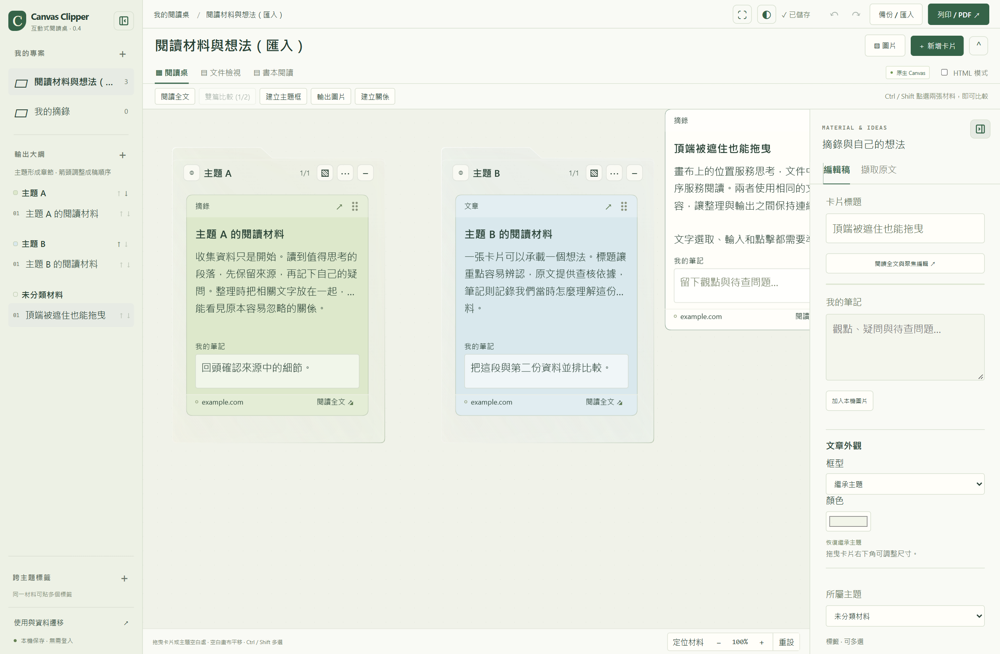
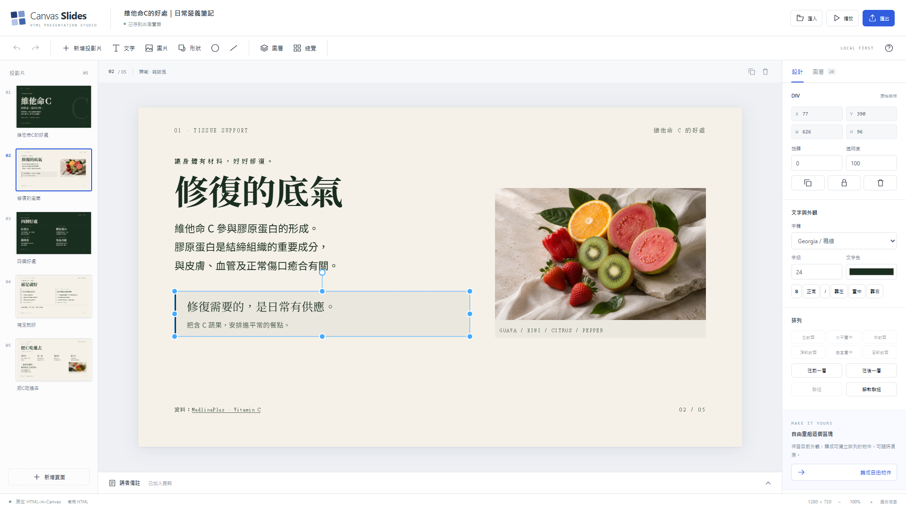
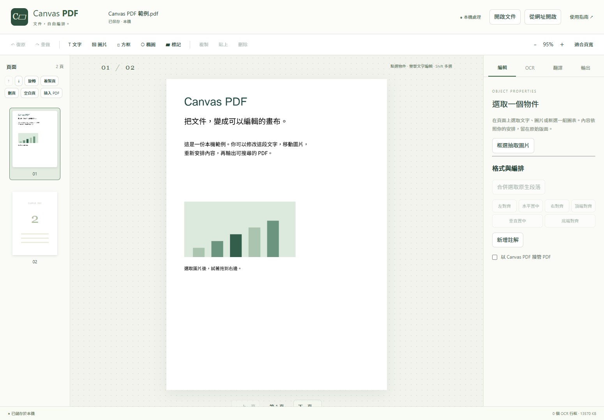

# Html in Canvas

以真實、可操作的 HTML 建立 Canvas 應用的開源插件系列。

**A collection of practical HTML-in-Canvas browser extensions and annotated examples.** Live DOM, native text input and accessible content, composed through Canvas 2D and WebGL.

## 第一個插件：Canvas Clipper

收集網頁圖文、並排閱讀、主題分類、標籤、關係連線、完整本機備份及可搜尋 PDF。

**Canvas Clipper v0.4.0**：把圖文整理成可操作的閱讀桌，讓視覺效果服務於分類、閱讀和輸出。新增面板邊緣收合、整卡拖曳、主題單元排序、方向性毛玻璃、可調字級及平滑自適應。



[下載 v0.4.0](https://github.com/show940125/Html-in-Canvas/releases/tag/canvas-clipper-v0.4.0) · [使用指南](Canvas%20Clipper/GUIDE.html) · [介面更新與技術評估](Canvas%20Clipper/UI_REFINEMENT.md) · [技術架構](docs/architecture.md) · [v0.3 操作影片](docs/media/canvas-clipper-v03.mp4)

- **磁吸自適應**：放下前預覽橫向／縱向插入，主題伸縮、周邊局部讓位，整次變更一步復原。
- **自己的工作區**：三區收合、六組主題色、深淺模式、六種框型及可調卡片尺寸。
- **讀出脈絡**：聚焦、雙篇比較、標籤與定向關係；長文真正分頁，以 WebGL 翻頁連續閱讀。
- **完整輸出**：含關係線的 PNG／JPEG 組圖、可搜尋 PDF、含原始圖片和閱讀位置的 ZIP v3。
- **實際技術細節**：真實 DOM、中文輸入、互動幾何、HTML 紋理、可開關的技術檢視與獨立範例。

空白閱讀桌可按「試用範例專案」建立獨立合成示例。原文與編輯稿分別保存，資料留在本機。

- `Canvas Clipper/`：插件原始碼、測試與建置工具。
- `shared/`：通用能力探測、繪製及互動座標相容層。
- `examples/`：可獨立執行的技術範例。
- `docs/`：架構、相容性與開發說明。

共用層只承擔 Canvas 瀏覽器能力；每個插件擁有自己的資料模型、互動及版本。

## 第二個插件：Canvas Slides（v0.1.2 本機預覽版）

把 AI 生成的 HTML 簡報帶進 Chrome 編輯：保留真實 HTML，提供文字、圖片、自由物件、圖層、群組、歸藏版型及本機專案備份。編輯舞台使用固定尺寸的隔離框架與 HTML-in-Canvas，並提供 HTML 相容模式。



[功能與安裝](Canvas%20Slides/README.md) · [開始使用](Canvas%20Slides/GUIDE.html) · [來源與適配](Canvas%20Slides/SOURCES.md) · [驗收邊界](Canvas%20Slides/ACCEPTANCE.md) · [Canvas 技術與優化方向](Canvas%20Slides/TECHNICAL.md)

Canvas Slides 擁有獨立的資料庫、建置與版本。一般 HTML 的未知腳本採受限匯入，Chrome 157 已通過原生自動驗證，實體 IME、GPU、跨螢幕 DPI、原生資料夾與系統列印仍待實機驗收。

## 第三個插件：失控 Canvas Runaway（v0.2.0 本機預覽版）

網頁區塊在原地聚成雙重曝光的人群：半透明的身體裡疊著原文與圖片，怪獸入侵後，內容帶著身體逃跑。滑鼠引導怪獸，可全部跑光，也可先記住目標網站，讓人群聚成終點畫面，再前往該網址。

[功能、安裝與界線](Canvas%20Runaway/README.md) · [開始使用](Canvas%20Runaway/public/start.html)

採原生 HTML-in-Canvas 紋理與生成的哥斯拉／人物 GIF 剪影，加入地裂與煙塵。支援社群 `div`／`span` 貼文及留言，可見區域最多 160 個內容區塊聚成 16 個角色。建置後有獨立離線預覽；原始碼以本機預覽版狀態入庫，尚未建立正式 Release 或商店發行。

## 第四個插件：Canvas PDF（暫停開發；v0.1.1 本機預覽版）

> **開發狀態：暫停（2026-11-08）**。依使用者指示暫停後續開發與驗收，現有程式、離線包、來源包及驗收紀錄保留；恢復開發等待使用者另行指示。

[暫停狀態紀錄](Canvas%20PDF/STATUS.md)

直接修改 PDF 段落、搬動圖片與圖形，辨識及校正掃描頁，並將譯文放回版面。使用 BentoPDF EditCore／PDFium、HTML-in-Canvas 與隨包提供的 PP-OCRv6 small／medium；預設本機 CPU 多緒，另可選 WebGPU。Chrome 本機翻譯優先，匿名 Gemini RPC 由使用者切換。



[功能與安裝](Canvas%20PDF/README.md) · [使用指南](Canvas%20PDF/public/GUIDE.html) · [驗收紀錄](Canvas%20PDF/ACCEPTANCE.md) · [來源與適配](Canvas%20PDF/SOURCES.md)

提供編輯版、搜尋版、譯文版、雙語配對頁、專案備份與離線套件。採獨立 AGPL-3.0-only 授權、資料庫與版本；既有三個插件維持原授權。原始碼以暫停時的快照入庫；實體 IME、使用者設定檔及真實文件人工 OCR 金標仍待驗收，尚未建立正式 Release 或商店發行。

[2026-11-08 入庫檢查與版本狀態](docs/repository-snapshot-2026-11-08.md) 記錄本輪提交範圍、驗證及本機產物排除方式。

## 開發

Node.js 24，Python 3.14 用於瀏覽器驗收。

```sh
npm --prefix "Canvas Clipper" ci
npm --prefix "Canvas Clipper" test
npm --prefix "Canvas Clipper" run build
```

在 Chrome 的擴充功能頁開啟開發人員模式，以「載入未封裝項目」選擇 `Canvas Clipper/dist`。資料存於使用中的瀏覽器設定檔；更新或移除前先匯出備份。

Chrome 156 需啟用 `canvas-draw-element` 實驗功能。程式依實際 API 能力探測；一般 HTML 模式提供閱讀、編輯及列印。

獨立範例：[examples](examples/README.md)。瀏覽器驗收與貢獻：[開發說明](docs/development.md)。環境限制：[相容性](docs/compatibility.md)。

## 更新與資料

更新前先下載全部專案備份。v3 匯入支援 v1／v2 備份；匯入建立副本。瀏覽器設定檔、快取、摘錄與備份均不進 Git。基礎權限使用 activeTab；網頁圖片按來源授權下載，無後端與 API key。

## 授權

共用層及既有三個插件的原創程式使用 [Apache-2.0](LICENSE)。Canvas PDF 整合 AGPL 元件，其衍生程式使用獨立的 [AGPL-3.0-only](Canvas%20PDF/LICENSE)。依賴及參考素材保留各自授權，見 [THIRD_PARTY_NOTICES.md](THIRD_PARTY_NOTICES.md)。本專案為獨立社群應用。
